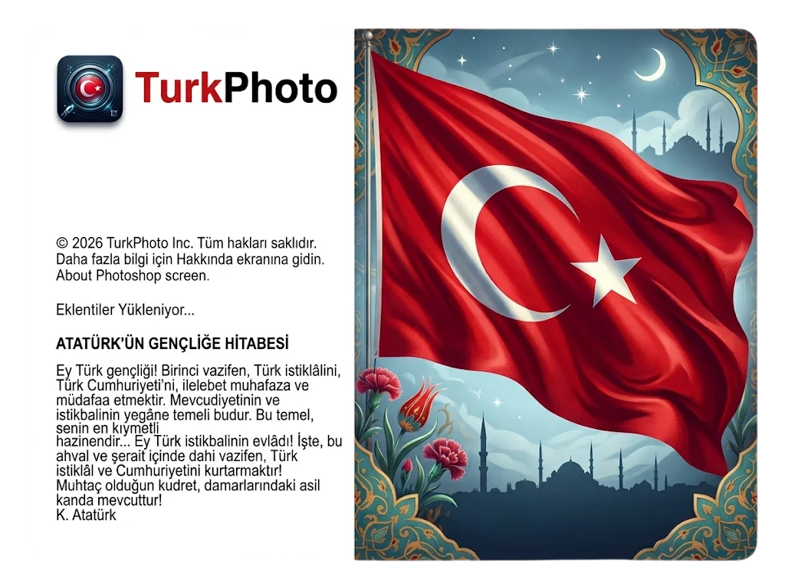

# 🎨 TurkPhoto

**TurkPhoto**, Python ve PyQt6 kullanılarak geliştirilmiş, Adobe Photoshop tarzı koyu temaya ve gelişmiş grafik düzenleme özelliklerine sahip masaüstü fotoğraf editörüdür.



---

## ✨ Öne Çıkan Özellikler

* **🎨 Photoshop Tarzı Koyu Arayüz:** Çift sütunlu sol araç çubuğu, sağ özellikler paneli ve geniş çalışma alanı (Canvas).
* **🚀 Yüksek Performans:** NumPy altyapısı sayesinde saliseler içinde çalışan resim filtreleri ve katman efektleri.
* **⚡ Hızlı Açılış:** Özel **Açılış Ekranı (Splash Screen)** ve çerçevesiz açılış deneyimi.
* **🌐 Çoklu Dil Desteği:** Türkçe ve İngilizce menü seçenekleri (Sağ üstten tek tıkla değişim).
* **🖌️ Düzenleme Araçları:** Sağa/sola döndürme, yatay aynalama, yakınlaştırma (Zoom), siyah-beyaz dönüştürme ve görsel sıfırlama.
* **💾 Çoklu Format Desteği:** PNG, JPG, JPEG ve BMP formatlarında açma ve kaydetme.

---

## 🛠️ Kurulum ve Çalıştırma

Projeyi kendi bilgisayarında çalıştırmak için aşağıdaki adımları takip edebilirsin:

### 1. Depoyu Klonla veya İndir
```bash
git clone [https://github.com/KULLANICI_ADI/TurkPhoto.git](https://github.com/KULLANICI_ADI/TurkPhoto.git)
cd TurkPhoto
